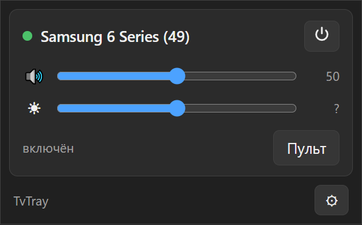
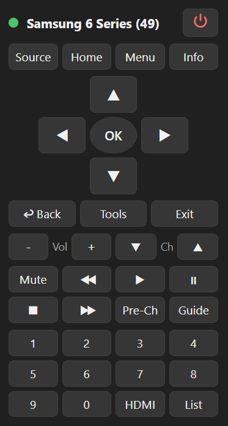
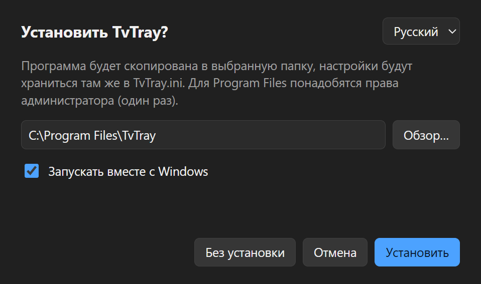
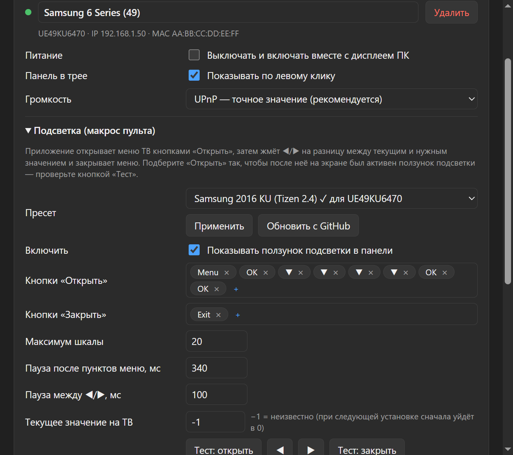
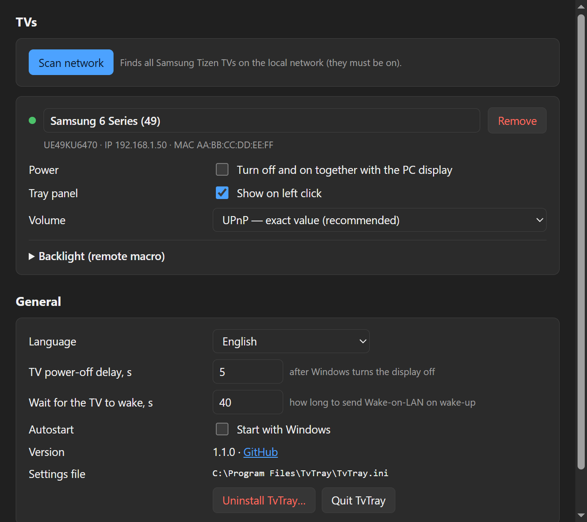
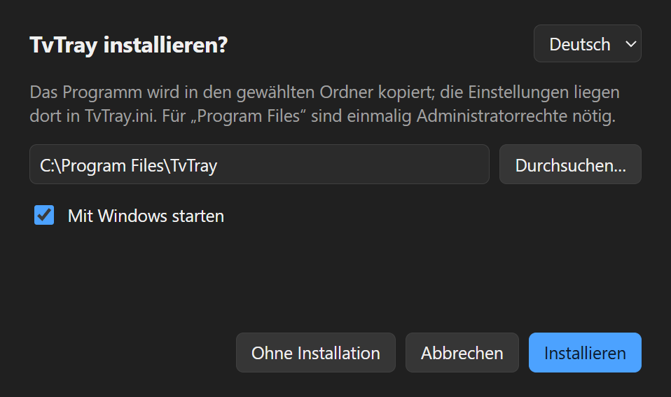

# TvTray

Иконка в трее Windows и Linux для телевизоров Samsung (Tizen), подключённых к ПК как монитор.

**Языки:** русский, English, Deutsch.

<p>
  
  
</p>

- **Питание вместе с ПК.** ТВ выключается, когда Windows гасит дисплей или уходит в сон, и включается через Wake-on-LAN, когда дисплей просыпается.
- **Панель по левому клику.** Для каждого ТВ: питание, громкость (UPnP — точное значение, или кнопками пульта), подсветка и кнопка полного пульта.
- **Подсветка.** У Samsung нет API для подсветки, поэтому TvTray проходит меню кнопками пульта. Последовательность для своей модели берётся из [пресетов](presets/) или набирается на мини-пульте в настройках.
- **Автоскан сети.** Находит все Samsung Tizen ТВ в локальной сети; можно управлять несколькими.
- **Один exe.** При первом запуске предлагает установиться в `Program Files\TvTray` (или работать без установки). Настройки хранятся в `TvTray.ini` рядом с exe.

## Установка

Скачайте `TvTray.exe` из [последнего релиза](https://github.com/angellfear/tvtray/releases/latest) и запустите. Установщик предложит язык, папку (по умолчанию `Program Files\TvTray`) и автозапуск.



### Linux

Скачайте `tvtray-linux-amd64.tar.gz`, распакуйте и запустите `./tvtray` — установщик положит программу в `~/.local/share/tvtray` (без root) и добавит её в меню приложений.

- Нужны GTK 3 и WebKit2GTK 4.1: `sudo apt install libgtk-3-0 libwebkit2gtk-4.1-0` (Debian 12+/Ubuntu 22.04+), `sudo dnf install gtk3 webkit2gtk4.1` (Fedora).
- Иконка в трее работает через StatusNotifierItem: KDE, XFCE, Cinnamon — сразу; GNOME — с расширением [AppIndicator](https://extensions.gnome.org/extension/615/appindicator-support/).
- Гашение дисплея определяется так: GNOME — точно (Mutter), X11 — по DPMS (нужен `xset`, пакет `x11-xserver-utils`), иначе — по включению хранителя экрана (KDE и др.). Сон — через logind.

## Настройки

Автоскан сети, флажки «вместе с ПК» и «в панели» для каждого ТВ, режим громкости, макрос подсветки с пресетами и мини-пультом для записи кнопок.



<details>
<summary>English / Deutsch</summary>



</details>

## Требования к ТВ

- Samsung на Tizen (2016+), в той же сети, что и ПК.
- Для включения по сети: «Общие → Сеть → Экспертные настройки → Включение с мобильного» = вкл. Лучше закрепить за ТВ IP в роутере.

Проверено на UE49KU6470 (2016) по Wi-Fi.

## Сборка

Нужен Go 1.26+.

```powershell
.\build.ps1 -Version 1.2.3   # Windows: build\TvTray.exe (CGO не требуется)
```

```sh
sh build.sh 1.2.3            # Linux: build/tvtray (нужны libgtk-3-dev и libwebkit2gtk-4.1-dev)
```

Диагностика из консоли: `go run . --scan`. Отладка рядом с установленной копией: `TVTRAY_INSTANCE=dev` (отдельный экземпляр) и `TVTRAY_DEVTOOLS=9333` (DevTools WebView2).

**Релиз:** `git tag v1.2.3 && git push origin v1.2.3` — GitHub Actions соберёт Windows- и Linux-версии и опубликует релиз (или Actions → Release → Run workflow).

Код на Wails v3 (WebView2 на Windows, WebKitGTK на Linux); всё ОС-зависимое — в `internal/platform`.

## Пресеты

См. [presets/README.md](presets/README.md). Новые модели приветствуются через pull request.
